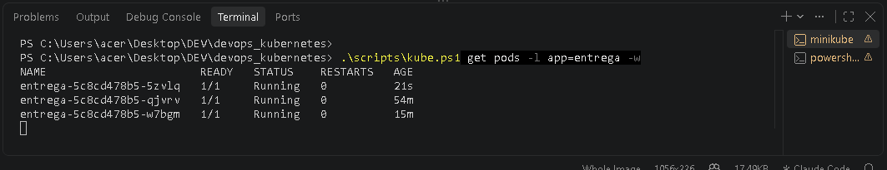
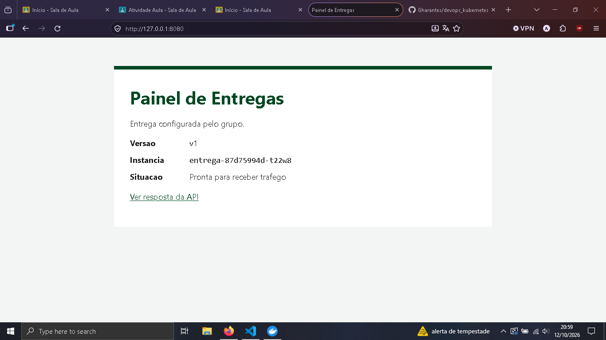
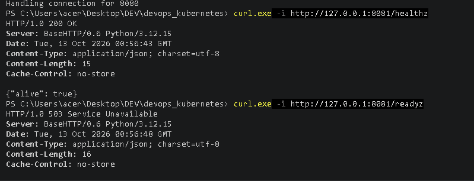
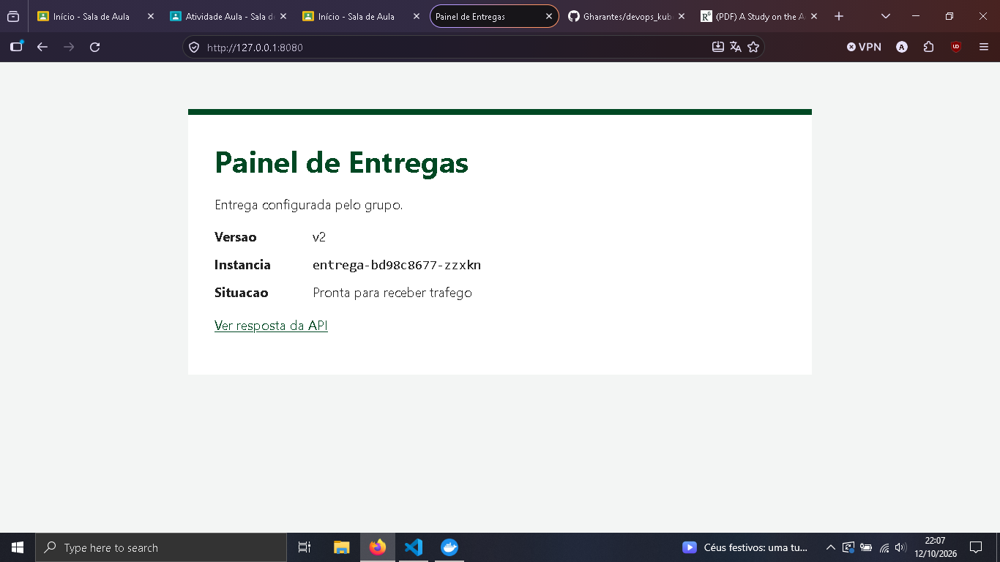
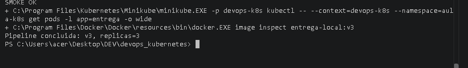

# Relato do grupo

Integrantes: Guilherme Harmatiuk Arantes
Data: 12/10/2026
Distribuição Linux: não se aplica — Windows 10 com Docker Desktop (WSL2)
Python 3.14.5 / Docker 29.5.2 / Minikube v1.39.0

## Etapas

### Etapa 1: Testes

**Comando:** `python -m unittest discover -s tests -v`

**Esperado:** 8 testes OK

**Observado:** `Ran 8 tests` / `OK`

### Etapa 2: Publicação v1

**Comando:** `.\scripts\kube.ps1 get pods -l app=entrega -o wide`

**Esperado:** 2 Pods prontos; API v1

**Observado:** 2 Pods `1/1 Running`; `/api/status` retorna `"version": "v1"`. A página mostra `v1` e a instância `entrega-5c8cd478b5-p6wc8`, um dos 2 Pods criados na publicação

### Etapa 3: Escala

**Comando:** `.\scripts\kube.ps1 get pods -l app=entrega`

**Esperado:** 3 Pods prontos

**Observado:** 3 Pods `1/1 Running`; os 2 antigos mantidos e 1 novo criado

### Etapa 4: Exclusão e recuperação

**Comando:** `.\scripts\kube.ps1 delete pod $podAntigo --wait=true`

**Esperado:** Nome antigo removido; novo Pod criado

**Observado:** `entrega-5c8cd478b5-p6wc8` removido; novo Pod `entrega-5c8cd478b5-5zvlq` criado; 3 Pods `1/1 Running`

### Etapa 5: ConfigMap

**Comando:** `.\scripts\kube.ps1 rollout restart deployment/entrega`

**Esperado:** Mensagem muda após recriar Pods

**Observado:** Após recriar os Pods, `/api/status` retorna `"version": "v1"`, `"message": "Entrega configurada pelo grupo."`

### Etapa 6: Atualização v2

**Comando:** `python scripts/smoke.py http://127.0.0.1:8080 --version v2 --message "Entrega configurada pelo grupo." --output evidencias/v2-status.json`

**Esperado:** 3 Pods v2 prontos

**Observado:** 3 Pods `1/1 Running`; `v2-status.json` retorna `"version": "v2"`, mensagem mantida

Número de revisão: 3
Imagem: v2

### Etapa 7: Incidente

**Comando:** `.\scripts\kube.ps1 describe pod $podNovo`; `curl.exe -i http://127.0.0.1:8081/healthz` e `/readyz`

**Esperado:** Novo Running 0/1; healthz 200, readyz 503

**Observado:** Pod `entrega-5c4465d9db-z5nkc` (imagem `quebrada`) `0/1 Running`, 0 reinícios; `/healthz` 200 e `/readyz` 503; os 3 Pods v2 continuam `1/1`

### Etapa 8: Rollback

**Comando:** `.\scripts\kube.ps1 rollout undo deployment/entrega --to-revision=3`

**Esperado:** v2 restaurada

**Observado:** Imagem `entrega-local:v2`; 3 Pods `1/1 Running`, Pod quebrado removido; `rollback-status.json` retorna `"version": "v2"`, mensagem mantida. Revisão passou a 5.

### Etapa 9: Pipeline v3

**Comando:** `python scripts/pipeline_local.py v3 3`

**Esperado:** Smoke OK e estado final v3

**Observado:** Imagem `entrega-local:v3`; 3 Pods `1/1 Running`; `status-v3.json` retorna `"version": "v3"`, mensagem mantida

## Respostas

1. Por que carregar a imagem no Minikube depois de construir no Docker?

    O `docker build` deixa a imagem só no Docker do computador. O nó do Minikube usa seu próprio runtime (containerd) e não enxerga essa imagem; o `image load` copia a imagem para dentro do nó, senão o Pod não acharia `entrega-local:v1`.

2. Qual a função das portas 8000, 80, 30080 e 8080?

   8000 é onde a aplicação escuta dentro do contêiner; 80 é a porta do Service; 30080 é a NodePort, que expõe o Service no IP do nó; 8080 é a porta local do computador aberta pelo `port-forward`, usada no navegador e no `curl`.

3. Por que o Pod excluído foi substituído?

   O Deployment pede 3 réplicas. Quando `entrega-5c8cd478b5-p6wc8` foi excluído, o controlador viu 2 Pods e criou outro (`entrega-5c8cd478b5-5zvlq`) para voltar a 3. É um Pod novo, com outro nome e IP, não o mesmo restaurado.

4. Por que três Pods no mesmo nó não protegem contra a perda da máquina?

   Os 3 Pods rodam no único nó `devops-k8s`. Se essa máquina parar, todos param juntos e não há outro nó para recriá-los. Réplicas só protegem contra falha de máquina se estiverem em nós diferentes.

5. Por que a mensagem não mudou imediatamente após aplicar o ConfigMap?

   A mensagem entra no Pod como variável de ambiente, lida só na inicialização. Alterar o ConfigMap não muda processos já em execução; foi preciso o `rollout restart` para criar Pods novos com o valor atualizado. Por isso não foi necessária nova imagem.

6. Tag de imagem e revisão do Deployment são a mesma coisa?

   Não. A tag (`v2`) identifica a imagem; a revisão identifica cada versão do modelo de Pods do Deployment. Na prática, a imagem `v2` ficou na revisão 3, porque o `rollout restart` do ConfigMap já tinha criado a revisão 2.

7. Que sinais mostram que a versão quebrada está viva, mas não pronta?

   O Pod `entrega-5c4465d9db-z5nkc` ficou `Running` com `READY 0/1` e 0 reinícios; `/healthz` retornou 200 e `/readyz` retornou 503; o `describe` mostrou `Readiness probe failed ... 503`. A liveness passa, então não há reinício, mas o Pod não recebe tráfego. A falha de readiness justifica abandonar a entrega.

8. O que o timeout fez? O que o rollback restaurou e o que não restaurou?

   O `--timeout=30s` só encerrou a espera do `rollout status`; não desfez nada. A reversão foi iniciada pelo `rollout undo --to-revision=3`, que restaurou o modelo dos Pods com a imagem `entrega-local:v2`. Não restaurou o ConfigMap (a mensagem continuou a atual), não alterou a quantidade de réplicas (continuou 3) e não alterou arquivos locais: `build/deployment.yaml` continuava descrevendo a versão quebrada.

9. Por que alinhar o arquivo gerado após a reversão?

   Depois do rollback, `build/deployment.yaml` ainda pedia a imagem `quebrada`. Se fosse aplicado de novo, publicaria a versão com defeito outra vez. Gerar o arquivo de novo com v2 e 3 réplicas faz o arquivo local representar o estado que queremos manter.

10. Quais verificações a pipeline realiza? Qual é seu limite?

   Ela confere Docker e Minikube, roda os 8 testes, recusa uma tag já existente, constrói e carrega a imagem, aplica os manifestos, espera o `rollout status` e faz o smoke test HTTP pela porta 18080; se algo falhar, para com erro, sem rollback automático. É local: precisa ser executada à mão e roda num só nó. Faltaria um servidor de CI acionado por alterações no código, um registro de imagens e um ambiente real. Mesmo concluída, ainda podem ocorrer falhas que o smoke test não cobre, como sob carga ou na perda do nó.

## Divergências e correções

### `docker build` falhou

**Hipótese:** Docker Desktop fechado

**Diagnóstico:** Mensagem de erro do build

**Sinal observado:** `failed to connect to the docker API at npipe:////./pipe/dockerDesktopLinuxEngine`

**Correção:** Abrir o Docker Desktop

### `apply` falhou

**Hipótese:** Cluster parado após o Docker fechar

**Diagnóstico:** `minikube -p devops-k8s status`

**Sinal observado:** `host: Stopped`, `apiserver: Stopped`

**Correção:** `minikube -p devops-k8s start`

### `kube.ps1` bloqueado em terminal novo

**Hipótese:** Política de execução do PowerShell

**Diagnóstico:** Mensagem de erro

**Sinal observado:** `running scripts is disabled on this system`

**Correção:** `Set-ExecutionPolicy -Scope Process -ExecutionPolicy Bypass`

### Port-forward caiu na Etapa 5

**Hipótese:** O Pod do encaminhamento foi recriado pelo `rollout restart`

**Diagnóstico:** Saída do port-forward

**Sinal observado:** `lost connection to pod`

**Correção:** Reabrir o port-forward
