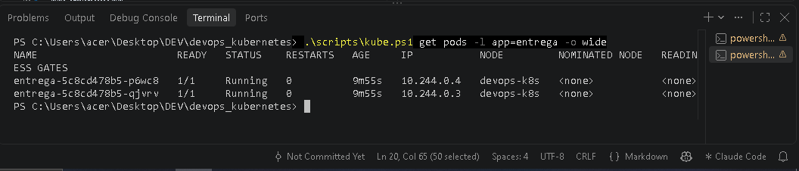
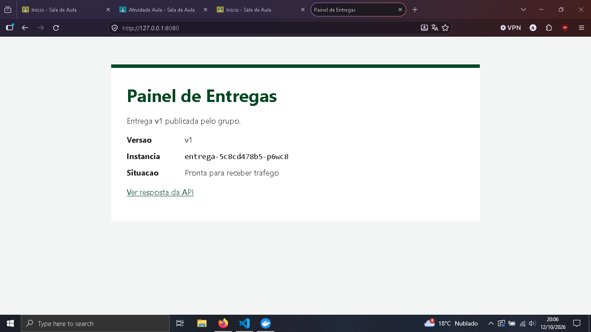

# Relato do grupo

Integrantes: Guilherme Harmatiuk Arantes
Data: 12/10/2026
Distribuição Linux:
Python 3.14.5 / Docker 29.5.2 / Minikube v1.39.0

## Etapas

### Etapa 1: Testes

**Comando:** `python -m unittest discover -s tests -v`

**Esperado:** 8 testes OK

**Observado:** `Ran 8 tests` / `OK`

### Etapa 2: Publicação v1

**Comando:** `.\scripts\kube.ps1 get pods -l app=entrega -o wide`

**Esperado:** 2 Pods prontos; API v1

**Observado:** 2 Pods `1/1 Running`; `/api/status` retorna `"version": "v1"`

### Etapa 3: Escala

**Comando:** `.\scripts\kube.ps1 get pods -l app=entrega`

**Esperado:** 3 Pods prontos

**Observado:** 3 Pods `1/1 Running`; os 2 antigos mantidos e 1 novo criado

### Etapa 4: Exclusão e recuperação

**Comando:** 

**Esperado:** Nome antigo removido; novo Pod criado

**Observado:** 

### Etapa 5: ConfigMap

**Comando:** 

**Esperado:** Mensagem muda após recriar Pods

**Observado:** 

### Etapa 6: Atualização v2

**Comando:** 

**Esperado:** 3 Pods v2 prontos

**Observado:** 

### Etapa 7: Incidente

**Comando:** 

**Esperado:** Novo Running 0/1; healthz 200, readyz 503

**Observado:** 

### Etapa 8: Rollback

**Comando:** 

**Esperado:** v2 restaurada

**Observado:** 

### Etapa 9: Pipeline v3

**Comando:** 

**Esperado:** Smoke OK e estado final v3

**Observado:** 

## Respostas

1. Por que carregar a imagem no Minikube depois de construir no Docker?
2. Qual a função das portas 8000, 80, 30080 e 8080?
3. Por que o Pod excluído foi substituído?
4. Por que três Pods no mesmo nó não protegem contra a perda da máquina?
5. Por que a mensagem não mudou imediatamente após aplicar o ConfigMap?
6. Tag de imagem e revisão do Deployment são a mesma coisa?
7. Que sinais mostram que a versão quebrada está viva, mas não pronta?
8. O que o timeout fez? O que o rollback restaurou e o que não restaurou?
9. Por que alinhar o arquivo gerado após a reversão?
10. Quais verificações a pipeline realiza? Qual é seu limite?

## Divergências e correções

Descreva hipótese, comando de diagnóstico, sinal observado e correção.
